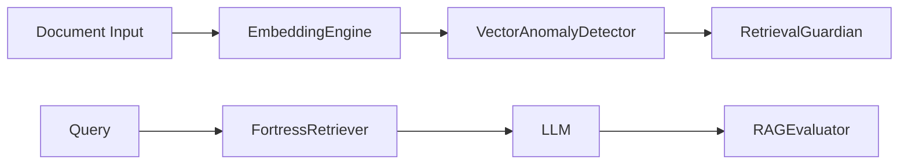

# rag-fortress

[](https://www.python.org/downloads/)
[](https://www.gnu.org/licenses/agpl-3.0)
[](.github/workflows/ci.yml)

> **Framework profesional de defensa para sistemas RAG** contra ataques de poisoning (`InceptionRAG`, MIA, context hijacking) con embeddings reales (`sentence-transformers`), detección de anomalías vectoriales (`IsolationForest` + heurística determinista) y evaluación de `Security Score` determinista.

---

## El Problema Real

Los sistemas RAG son vulnerables a ataques documentados en papers recientes:
- **InceptionRAG** (`arXiv:2609.16818`): Ataques sigilosos que fragmentan payloads en pasajes inofensivos, activados por razonamiento multi-hop.
- **Formal Threat Model** (`arXiv:2509.20324`): Formalización sistemática de amenazas RAG (integridad, confidencialidad, disponibilidad).
- **Taxonomía de Defensas** (`arXiv:2604.08304`): Las defensas actuales (`SD-RAG`, `AC-RAG`, `SEAL-Tag`) son fragmentadas.

No existe un framework unificado open-source que integre sanitización vectorial, detección de anomalías y evaluación de robustez.

---

## Arquitectura



- **EmbeddingEngine**: Codificación determinista (`all-MiniLM-L6-v2`, 384 dimensiones) con validación matemática de la forma del tensor.
- **VectorAnomalyDetector**: `IsolationForest` + heurística determinista (distancia coseno al centroide de la base legítima) para detectar `poisoning`.
- **RetrievalGuardian**: Verificación de relevancia (`Jaccard`) y bloqueo de `MIA` con patrones de PII y metadatos.
- **FortressRetriever**: Interceptor tipo `LangChain` que aplica la verificación antes de pasar chunks al generador.
- **RAGEvaluator**: `Security Score` determinista `0-100` con fórmula matemática verificada.

---

## Quickstart

```python
from rag_fortress import IngestionSanitizer, RetrievalGuardian, RAGEvaluator

sanitizer = IngestionSanitizer()
guardian = RetrievalGuardian()
evaluator = RAGEvaluator()
```

**Proteger un pipeline existente (drop-in con LangChain):**

```python
from rag_fortress.integrations.langchain_guard import FortressRetriever

guard = FortressRetriever()
clean_chunks = guard.retrieve("tema IA", retrieved_chunks)
```

---

## Security Score

El `RAGEvaluator` calcula un `Security Score` determinista:

```
score = (attacks_blocked / total_attacks) * 100 - (utility_drop * 10)
```

Acotado en `[0, 100]`. Verificado con `property-based testing` (`hypothesis`).

---

## Instalación

```bash
git clone https://github.com/amurlaniakea/rag-fortress.git
cd rag-fortress
pip install -e ".[dev]"
```

### Dependencias Principales
- `pydantic` — Contratos de datos e interfaces entre módulos.
- `scikit-learn` — `IsolationForest` para detección de anomalías vectoriales.
- `sentence-transformers` — Embeddings profesionales (`all-MiniLM-L6-v2`, 384 dimensiones).
- `transformers`, `torch` — Pipeline de inferencia semántica avanzada.
- `hypothesis` — `Property-based testing` para validar propiedades matemáticas de embeddings y detección.

---

## Modelo de Seguridad

- **STRIDE aplicado**: `Sanitizer` cubre `Tampering` y `Information Disclosure`; `Guardian` cubre `Spoofing` y `Elevation of Privilege`; `Evaluator` cubre `Denial of Service` (context hijacking).
- **Limitaciones conocidas**: Este framework protege la capa de recuperación/conocimiento externo del RAG. No protege al LLM generador contra inyección de prompt directa en la entrada final del usuario.

---

## Estrategia de Pruebas

- **Property-Based Testing**: `hypothesis` valida que `encode()` siempre devuelve un tensor con `shape == (n, 384)` y que `VectorAnomalyDetector` detecta vectores estadísticamente extremos con determinismo matemático.
- **Tests Deterministas**: No hay datos aleatorios ocultos. Todos los `assert` son matemáticamente verificables.
- **CI Automático**: `tests/test_professional_core.py`, `tests/test_sanitizer.py`, `tests/test_guardian.py`, `tests/test_evaluator.py` se corren en cada `push` y `pull_request` (`.github/workflows/ci.yml`).

---

## Roadmap

| Fase | Milestone | Estado |
|------|-----------|--------|
| v0.1.0-alpha | Core funcional (Sanitizer, Guardian, Evaluator, Interceptor) | ✅ Completado |
| v1.0.0-alpha | Professional Grade: Embeddings reales (`384-dim`), `IsolationForest`, `Property-Based Testing`, `LangChain` adapter configurable | ✅ Completado | 
| v2.0.0 | Defensas adaptativas (`online` learning con actualización del `IsolationForest` en producción) | Planificado |

---

## Referencias Académicas Verificadas

- `arXiv:2609.16818` — InceptionRAG: Ataques sigilosos de `poisoning` en sistemas RAG.
- `arXiv:2509.20324` — Modelo formal de amenazas para `Retrieval-Augmented Generation`.
- `arXiv:2604.08304` — Taxonomía completa de ataques, defensas y benchmarks de `RAG Security`.
- `arXiv:2610.12524` — Vulnerabilidades de propagación en `Multi-Agent Systems` (referencia para futuras integraciones `MAS`).
- `arXiv:2603.09002` — Evaluación cuantitativa de `16 frameworks` de seguridad `MAS`.

---

## Licencia

**AGPL-3.0-or-later** — Ver archivo `LICENSE` (`661` líneas, texto oficial `GNU`).

---

> **"La innovación no viene de tener ideas originales. Viene de encontrar problemas reales que otros han investigado pero nadie ha resuelto, y construir la solución."**
> *— Método de Encuentra Nicho, Obsidian Vault (`llm-wiki/METODOS/Metodo_Encuentra_Nicho.md`)*

---

## Autor

**Pedro Sordo Martínez** — `amurlaniakea@gmail.com`

`SPDX-FileCopyrightText: 2026 Pedro Sordo Martínez <amurlaniakea@gmail.com>`
`SPDX-License-Identifier: AGPL-3.0-or-later`
